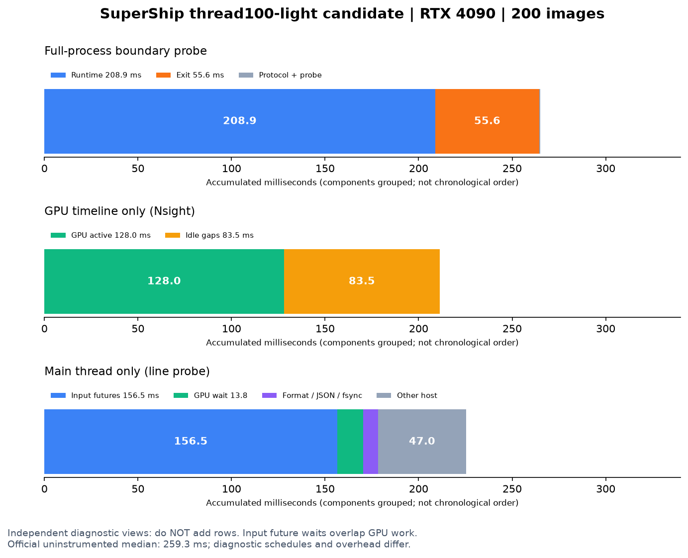

# 最新最快候选性能诊断

实验 `20261026-083341-profile-thread100`；Codex /root；分支 `exp/profile-thread100-20261026`；状态 **completed**，2026-10-26 08:37 CST。GPU0 RTX4090 独占08:34–08:35，已核实空闲并释放。未改推理代码、计时器、评分器；未进行竞赛提交，最近Accepted258.409792ms和候选推荐均保持。

测试目标是 `thread100-light`，不是main默认standard入口。父版本完整SHA `1da325e5a7cf4fe3ff485855622dc22100fd848a`，推理实现源SHA `cda34913ed3cec8de577d151ee3a16984f46a5ed`；实际运行提交 `7125ee3926520987a6a043dbace2d94f1a08e9c0`（完整SHA见runs.json及每个command.json）。全部生产文件与父版本相同，无未提交推理补丁。配置完整列于config.json：544、batch8、10解码线程、depth3、FP16/CUDA Graph、半尺寸JPEG、top100、线程化JSON、精简导入及父版本融合/THP设置。

## 正式完整协议三轮

| 轮次 | 完整端到端ms | reference AP50 | 图像数 | 检测数 |
| --- | ---: | ---: | ---: | ---: |
| 1 |259.257667|0.7809|200|6102|
| 2 |251.140982|0.7809|200|6102|
| 3 |266.716015|0.7809|200|6102|

中位数 **259.257667ms**，约771.4张/秒；与历史Accepted258.409792ms相差+0.328%，属于复现，不宣称提速。READY后访问全部输入，计时包含fsync、输出关闭、任务完成和进程退出。reference实际基线0.7935，98%门槛0.77763，比值0.984121，绝对裕量0.00327。**validation AP50=null；hidden AP50=null；官方隐藏集最优未知**。当前公开集结果不能作为RTX3090或隐藏集成绩。

## 完整进程边界与波动

下表每行来自同一次独立诊断，可相加；诊断开销与正式计时分开。

| 轮次 | Runtime.run ms | 退出ms | 探针落盘ms | 协议剩余ms | 合计ms |
| --- | ---: | ---: | ---: | ---: | ---: |
| 1 |209.936574|49.744251|0.361299|0.257239|260.299363|
| 2 |208.895030|55.615320|0.307349|0.247869|265.065568|
| 3 |267.360711|50.769368|0.280529|0.261779|318.672387|

独立IO三轮核心208.135484/211.949972/208.771897ms，退出55.770202/55.433455/51.925368ms，完整264.476704/268.004834/261.230073ms。正常核心约208–212ms，退出约50–56ms，占完整运行约19–21%。边界第三轮318.672ms异常由核心267.361ms造成，不能归为退出抖动；未采到该轮更细粒度证据，原因未确定，原结果保留。

## CPU供给：当前优先瓶颈

三轮IO探针核心平均使用8.72/8.41/8.68个CPU核，宿主可用10核EPYC7402。逻辑读取58,390,962bytes，物理read_bytes=0、major_faults=0：本次是热缓存输入，当前证据指向解码/预处理而非物理磁盘。不能推断冷盘或4300张隐藏集。

三轮解码任务总服务时间1970.63/1895.29/1864.34ms（10线程重叠），墙钟跨度207.59/197.47/192.33ms。

| 操作 | 三轮线程服务总和ms | 每图中位数ms |
| --- | --- | --- |
| imread（文件访问+半尺寸JPEG解码）|1592.61 /1530.67 /1516.85|7.413 /6.923 /6.984|
| resize |308.58 /303.30 /292.36|1.335 /1.199 /1.136|
| cvtColor |48.00 /39.90 /33.96|0.120 /0.110 /0.112|

imread占load_image服务约81%，单图最长20.5–24.4ms，按序批次有等待慢图的风险。主线程Future等待156.493/147.989/154.075ms与GPU运行重叠，**不是纯GPU空闲时间**，也不能与GPU时间相加。

## GPU独立时间线

| Nsight轮次 | kernel总和ms | GPU活动并集ms | 首末活动跨度ms | 无GPU活动空档ms | 时间线覆盖率 |
| --- | ---: | ---: | ---: | ---: | ---: |
| 1 |118.160588|127.957962|211.408770|83.450808|60.53%|
| 2 |118.062985|127.947852|192.465060|64.517208|66.48%|

活动包含kernel和传输；覆盖率不是SM利用率。64.5–83.5ms空档支持供给/调度瓶颈，但不是可直接兑现的等量提速。未采硬件计数器，不断言显存带宽或计算饱和。Nsight开关及导出使其端到端耗时7.441/7.444秒，**这些诊断时间不是性能分数**。

每轮25次Graph、18,900个kernel，约13,354个不足5us。可进一步分析的GPU族：CUTLASS GEMM族9.58ms、特征pack7.89ms/350次、FP16 add5.83ms、FP16 copy4.74ms、融合relu_affine4.64ms。它们是kernel名称族，不等同完整模块耗时。H2D9.60–9.69ms（177.56MB）、D2H约0.047ms（0.48MB），回传不是当前主要问题。

线程化JSON最终Future等待0.115–0.132ms，拼接0.144–0.325ms，fsync5.68–6.07ms；线程服务在流水线内重叠，因此最终等待小不代表序列化免费，但继续只优化末尾JSON收益空间有限。

## 后续优先级

1. 优先验证CPU解码服务和批次供给：针对慢图造成的批次等待、解码实现与resize代价提出单一假设；先查既有50方向结果，避免重复线程数/排序等已测配置。10核已用约8.4–8.7核，不能假设盲目增加线程有效。
2. 检查剩余退出阶段主机页/驱动资源回收：50–56ms仍是固定短集税负；保留THP，既有empty_cache/reset失败方案不重复推荐。此次只测边界，未重新证明具体退出内部归因。
3. GPU特征pack与相邻算子融合：pack约7.89ms及大量小kernel值得进一步映射到模型；已有affine融合继续保留，不把历史旧版转换开销直接套到新版。

## 复现与检查

环境：RTX4090，driver550.142，EPYC7402/10可用核，PyTorch2.6.0+cu124，cuDNN90100，OpenCV4.11.0，Triton3.2.0，Nsight2024.2.3。完整环境在verification.json。

在本诊断分支建立新的隔离worktree，准备与checksums.json匹配的数据/权重，调整config.json本机路径后运行：

```bash
/home/ubuntu/.cache/supership-venv/bin/python -u experiments/20261026-083341-profile-thread100/run.py
/home/ubuntu/.cache/supership-venv/bin/python experiments/20261026-083341-profile-thread100/analyze.py
PYTHONPATH=/tmp/supership-profile-plot-deps /home/ubuntu/.cache/supership-venv/bin/python experiments/20261026-083341-profile-thread100/plot.py
```

驱动拒绝已存在输出目录；不要覆盖历史。run.py实际命令、完整SHA和覆盖配置保存在每个command.json。本次14个输出均通过官方格式检查/评分，AP50均0.7809，全部字节一致且与父版本相同，SHA256 `4185ed612afb8234afae8e31eb43bafd0b68ef32c124d0d510d2da745f29100c`。三轮line探针各200个唯一load任务、各200次decode/resize/cvtColor。200是batch8整批；尾批能力沿用未改代码的父版本测试，本次未新增尾批测试。确认engine/supership/run.sh无差异，计时器/评分器/权重及200图像checksum与父manifest一致；阶段区间守恒、Python编译和git diff检查通过。未新增推理测试或主存硬限额测量。

原始预测、日志、Nsight报告/SQLite、全部SHA256保留在本机 `/tmp/SuperShip-profile-thread100-20261026/output/20261026-083341-profile-thread100/`，main的output同ID链接到此。Git只存脚本、配置、校验和、摘要和图。外部机器需要公开数据/权重及匹配依赖重新运行，本机路径不是可移植完整产物。



---

原始登记：

# Latest thread100-light performance diagnosis

Experiment20261026-083341-profile-thread100; owner Codex /root; status running.
Parent1da325e5a7cf4fe3ff485855622dc22100fd848a; production sourcecda34913ed3cec8de577d151ee3a16984f46a5ed. No production source changes. GPU0 RTX4090 reserved08:34 CST after idle audit. Public200 reference only, baseline3 and independent boundary3/line3/io3/Nsight2 diagnostics. No larger validation or competition upload. Exact effective overrides in config.json and actual commands/source in each case/command.json. Probe scripts adapted from20261026-002932-profile-thp; threaded JSON final wait explicitly classified. Full outputs retained locally under output/20261026-083341-profile-thread100.
